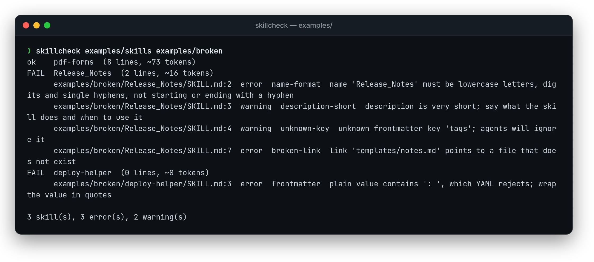

<p align="center">
  
</p>

<p align="center">
  <a href="https://github.com/celaldrg/skillcheck/actions/workflows/ci.yml"></a>
  <a href="LICENSE"></a>
  
  
  <a href="https://github.com/celaldrg/skillcheck/releases"></a>
</p>

**Lint Agent Skills before your agent loads them.**

Agent Skills are folders with a `SKILL.md` file that Claude Code, OpenAI Codex, Cursor, GitHub Copilot and other agents load on demand. A skill with a bad name, a frontmatter typo or a missing reference file usually fails silently: the agent never picks it up, or it picks it up and then can't find the file it was told to read. `skillcheck` catches those mistakes in your editor or in CI.

- Checks the [open SKILL.md format](https://agentskills.io/specification): `name` and `description` rules, length limits, optional fields.
- Reads frontmatter with a strict parser and reports the exact line, such as an unquoted `: ` that real YAML loaders reject.
- Finds links to bundled files that don't exist or point outside the skill folder.
- Warns about descriptions that never say *when* to use the skill, bodies that are too long for the context window, duplicate skill names, and scripts that aren't executable.
- Text, JSON and GitHub Actions annotation output. No dependencies, Python 3.9+.

<p align="center">
  
  <br><sub>Real output: <code>skillcheck examples/skills examples/broken</code></sub>
</p>

## Install

```bash
pip install git+https://github.com/celaldrg/skillcheck
# or run it without installing
pipx run --spec git+https://github.com/celaldrg/skillcheck skillcheck .
```

## Usage

```bash
skillcheck                      # search the current folder for skills
skillcheck .claude/skills       # a folder of skills
skillcheck path/to/my-skill     # one skill
skillcheck --strict             # warnings fail too
skillcheck --format json        # machine-readable
skillcheck --ignore unknown-key # skip a rule
```

Exit codes: `0` clean, `1` errors (or warnings with `--strict`), `2` no skills found.

## Example

<p align="center">
  
  <br><sub>Recorded with <a href="https://github.com/charmbracelet/vhs">vhs</a>.</sub>
</p>

Run against this repo's [examples](examples):

```text
$ skillcheck examples/skills examples/broken
ok    pdf-forms  (8 lines, ~73 tokens)
FAIL  Release_Notes  (2 lines, ~16 tokens)
      examples/broken/Release_Notes/SKILL.md:2  error  name-format  name 'Release_Notes' must be lowercase letters, digits and single hyphens, not starting or ending with a hyphen
      examples/broken/Release_Notes/SKILL.md:3  warning  description-short  description is very short; say what the skill does and when to use it
      examples/broken/Release_Notes/SKILL.md:4  warning  unknown-key  unknown frontmatter key 'tags'; agents will ignore it
      examples/broken/Release_Notes/SKILL.md:7  error  broken-link  link 'templates/notes.md' points to a file that does not exist
FAIL  deploy-helper  (0 lines, ~0 tokens)
      examples/broken/deploy-helper/SKILL.md:3  error  frontmatter  plain value contains ': ', which YAML rejects; wrap the value in quotes

3 skill(s), 3 error(s), 2 warning(s)
```

## Rules

| Rule | Level | What it catches |
| --- | --- | --- |
| `missing-skill-md`, `file-name` | error | No `SKILL.md`, or one named `skill.md` / `Skill.md` |
| `frontmatter` | error | Missing, unclosed or invalid frontmatter, duplicate keys, tabs |
| `name-missing`, `name-format`, `name-length` | error | `name` must be 1 to 64 lowercase letters, digits and single hyphens |
| `name-dir-mismatch` | error | `name` must equal the folder name |
| `name-reserved` | warning | Names containing `claude` or `anthropic`, which some platforms refuse |
| `description-missing`, `description-length` | error | `description` is required, at most 1024 characters |
| `description-short`, `description-no-trigger` | warning | The description doesn't say what the skill does and when to use it |
| `description-person`, `description-xml` | warning | First-person descriptions, XML-like tags |
| `compatibility-length`, `*-type` | error | Wrong types for optional fields, `compatibility` over 500 characters |
| `unknown-key` | warning | Frontmatter keys no agent reads (common agent-specific keys are allowed) |
| `body-empty`, `body-long` | warning | No instructions, or more than 500 lines / about 5000 tokens |
| `broken-link` | error | A relative Markdown link to a file that isn't in the skill |
| `link-outside`, `absolute-link`, `backslash-path` | warning | Links that won't survive the skill being copied elsewhere |
| `duplicate-name` | error | Two skills in the scanned paths share a name |
| `script-not-executable` | warning | A script under `scripts/` has a shebang but no execute bit |

## In GitHub Actions

```yaml
- uses: actions/setup-python@v5
  with:
    python-version: "3.12"
- run: pip install git+https://github.com/celaldrg/skillcheck
- run: skillcheck .claude/skills --format github
```

With `--format github`, problems show up as annotations on the pull request diff.

## In Python

```python
from skillcheck import check_paths

for skill in check_paths([".claude/skills"]):
    for f in skill.findings:
        print(f.path, f.line, f.level, f.rule, f.message)
```

## Credits

The rules follow the public [Agent Skills specification](https://agentskills.io/specification) and Anthropic's published skill-authoring guidance. skillcheck is an independent project and isn't affiliated with any agent vendor.

## License

[MIT](LICENSE)
